<div align="center">
  
</div>

<div align="center">

[**`[ portfolio ]`**](https://minhpham06.com) &nbsp; [**`[ linkedin ]`**](https://www.linkedin.com/in/nhat-minh-pham-a870382a8) &nbsp; [**`[ projects ]`**](https://github.com/nhatminh06?tab=repositories)

</div>

### `minh@github:~$ cat about.txt`

```text
I build dependable systems close to the hardware and useful in production.

Currently exploring the intersection of distributed systems, Linux,
computer architecture, GPU performance, and machine learning systems.
```

### `minh@github:~$ ls -lah ~/featured-projects`

| Permissions | Repository | What I'm building |
| :--- | :--- | :--- |
| `drwxr-xr-x` | **[TensorForge](https://github.com/nhatminh06/tensorforge)** | GPU roofline modeling, profiling, and performance analysis with PyTorch and CUDA. |
| `drwxr-xr-x` | **[QuorumKV](https://github.com/nhatminh06/quorumkv)** | A distributed key-value store built around Raft consensus and fault tolerance. |
| `drwxr-xr-x` | **[WireStack](https://github.com/nhatminh06/wirestack)** | A TCP/IP stack built from scratch to understand how packets move through a network. |
| `drwxr-xr-x` | **[Aegis](https://github.com/nhatminh06/aegis)** | Secure GitOps private-cloud platform with Kubernetes, FluxCD, Cilium, and Kyverno. |
| `drwxr-xr-x` | **[CommerceCore](https://github.com/nhatminh06/commercecore)** | Event-driven commerce backend focused on transactional correctness and failure recovery. |
| `drwxr-xr-x` | **[Linux Kernel Lab](https://github.com/nhatminh06/linux-kernel-lab)** | Linux kernel, QEMU, and device-driver experiments. |

### `minh@github:~$ cat /etc/tech-stack`

```yaml
languages: [C++, C, Go, Python, Java, TypeScript, SQL, Bash]
systems: [Linux, Raft, TCP/IP, Operating Systems, Computer Architecture]
infrastructure: [Docker, Kubernetes, FluxCD, Terraform, GitHub Actions]
data: [PostgreSQL, Kafka, Redis]
ml_systems: [PyTorch, CUDA, NVML, MLflow]
```

### `minh@github:~$ ./what-im-working-on.sh`

```diff
+ Performance engineering for efficient AI on real hardware
+ Distributed systems and systems software
+ Building, measuring, breaking, and fixing production-like systems
```

### `minh@github:~$ cat principles.ini`

```ini
[engineering]
measure  = "before optimizing"
automate = "what should be reproducible"
test     = "failure paths, not just the happy path"
document = "the details future me will forget"
ship     = "systems that actually work"
```

---

<div align="center">

<sub><code>minh@github:~$ echo "Thanks for visiting."</code></sub>

</div>
